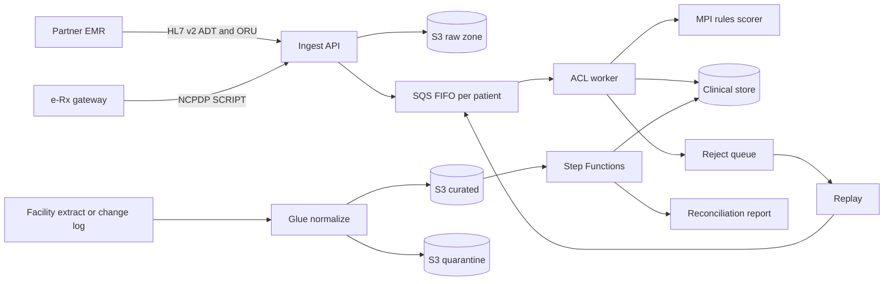

# EMR migration and sync

A reference pipeline for moving clinical messages from a partner system into a wound care record. It accepts HL7 v2 ADT and ORU messages and a subset of NCPDP SCRIPT, maps them to FHIR R4, and loads a facility history through the same apply path. The sample messages are synthetic. Nothing here is connected to a live partner, a pharmacy network, or a production account.

The latency numbers in [docs/architecture.html](docs/architecture.html) are design targets. They have not been measured.

## What it does

- Stores every inbound payload in an immutable raw zone, then queues a pointer.
- Orders work per patient on an SQS FIFO queue. The group id is a hash, so the queue metadata does not carry the medical record number.
- Parses and validates ADT A01, A03, A08, ORU R01, and SCRIPT `NewRx`, `CancelRx`, `RxRenewalRequest`, `RxRenewalResponse`, `RxFill`, and `RxHistoryResponse`.
- Maps accepted messages to FHIR R4 `Patient`, `Encounter`, `Observation`, `DiagnosticReport`, `MedicationRequest`, `MedicationStatement`, and `Condition` resources.
- Upserts by a deterministic id. A repeated delivery of the same control id and body is a no-op.
- Sends poison messages and control-id conflicts to a reject queue that can be replayed from the raw object.
- Pauses a partner whose messages keep failing, without pausing anyone else. The raw object is still stored.
- Matches patients with a rules scorer. A birth-date or sex disagreement is held for review and is not merged.
- Checks facility extracts with the same row rules the Glue job uses, then reconciles every source id as matched, rejected, or pending review.
- Applies an ordered change log (the stand-in for a database change stream) with a per-key sequence checkpoint.
- Writes an audit event for each accept, reject, replay, and review. Logs are filtered so names, raw payloads, and common identifier patterns do not land in the log line.

## Architecture



The isometric figure is in [docs/architecture.html](docs/architecture.html). It opens in a browser with no build step.

Live messages and batch rows meet at `resolve_patient` and the FHIR builders. A CSV row does not get turned back into HL7. Both paths upsert the same resource shapes.

## Layout

| Path | Role |
| --- | --- |
| `src/emr_sync/` | Parsers, mapping, matching, pipeline, CLI, Lambda handlers |
| `jobs/normalize_facility_extract.py` | AWS Glue entry point (PySpark) |
| `infra/` | CDK app and the migration state machine |
| `samples/` | Synthetic HL7, SCRIPT, CSV, and change-log files |
| `tests/` | Unit tests and the in-memory pipeline |
| `docker-compose.yml` | LocalStack for S3, SQS, and DynamoDB |

## Run the tests and the demo

Requires Python 3.11 or newer.

```bash
python3 -m venv .venv
source .venv/bin/activate
pip install -e ".[dev]"
pytest
ruff check src tests jobs infra
python -m emr_sync.cli demo
```

`demo` uses an in-memory pipeline, prints counts and reason rollups, and does not print patient names. `make test` and `make demo` call the same commands.

Ingest and work as two processes, with state under `.local/` (gitignored):

```bash
python -m emr_sync.cli ingest samples/hl7/adt_a01.hl7 --partner snf01 --source PARTNER_EMR
python -m emr_sync.cli work
python -m emr_sync.cli migrate samples/migration/facility_a --facility-id facility_a
python -m emr_sync.cli sync samples/cdc/facility_a.jsonl --facility-id facility_a
python -m emr_sync.cli replay
```

`--backend memory` keeps everything in one process. `--backend dir` is the default for those commands.

### LocalStack

Docker is required. The compose file starts LocalStack and the init script creates the buckets, FIFO queues, and tables the adapter expects.

```bash
docker compose up -d
export AWS_ACCESS_KEY_ID=test
export AWS_SECRET_ACCESS_KEY=test
export AWS_DEFAULT_REGION=us-east-1
export AWS_ENDPOINT_URL=http://localhost:4566
python -m emr_sync.cli --backend aws ingest samples/hl7/adt_a01.hl7 \
  --partner snf01 --source PARTNER_EMR
python -m emr_sync.cli --backend aws work
```

Default names are `emr-sync-raw`, `emr-sync-curated`, `emr-sync-quarantine`, `emr-sync-reports`, `emr-sync-inbound.fifo`, `emr-sync-rejects.fifo`, and the DynamoDB tables `emr-sync-idempotency`, `emr-sync-audit`, `emr-sync-clinical`, and `emr-sync-review`. Override them with `RAW_BUCKET`, `INBOUND_QUEUE_URL`, and the other variables read in `emr_sync.aws_backend`.

LocalStack in this compose file covers S3, SQS, and DynamoDB. Glue and Step Functions are exercised by the PySpark entry point and by the state-machine definition, not by this container.

### Glue job on a laptop

```bash
pip install -e ".[dev,spark]"
pytest tests/test_glue_job.py
```

The job reads the three CSVs under `--input_prefix`, writes Parquet plus a JSON Lines manifest to `--curated_prefix`, and writes failing rows to `--quarantine_prefix`. The manifest is what the load function reads, so that function stays on the standard Lambda runtime.

### Synthesize the stack

```bash
pip install -e ".[infra]"
npx --yes aws-cdk@2.1147.0 synth
```

`cdk synth` uses account `111111111111` and region `us-east-1` when no account is configured, so it does not need credentials. For a real account pass `-c account=123456789012 -c region=us-east-1`. Deploy is `npx aws-cdk deploy` after the account is bootstrapped. This repository does not deploy anywhere.

## Messages

HL7 v2.x, types `ADT^A01`, `ADT^A03`, `ADT^A08`, and `ORU^R01`. The parser reads MSH, PID, PV1, OBR, and OBX. Rejection reasons are stable codes such as `MISSING_PID` and `INVALID_DOB`. The reason does not include the bad value.

SCRIPT messages are a small XML subset. Element lookup uses local names, so a default namespace is fine. `NewRx` becomes an active `MedicationRequest`. `CancelRx` and `RxFill` update that request when the prescriber order number or `RelatesToMessageId` matches. A renewal is a new request with `priorPrescription` set. `RxHistoryResponse` becomes one `MedicationStatement` per medication.

NDC values are stored as digits. An NDC with dashes in a CSV is accepted when it has 10 or 11 digits.

## Patient matching

`emr_sync.mpi.compare` scores two demographic records:

| Signal | Points |
| --- | --- |
| Birth date equal | 40 |
| Sex equal, and both are M, F, or O | 10 |
| Family name equal | 25 |
| Family name Soundex equal | 12 |
| Given name equal | 15 |
| Given name shares a 3-letter prefix | 8 |
| Phone matches on the last 7 or 10 digits | 10 |

A score of 85 or more links the inbound record onto the existing patient and adds the new identifier. Demographics on that patient stay as they were. A score from 60 to 84 opens a review row and a provisional patient. Below 60 the inbound record is stored on its own.

Two hard stops force review even when the rest of the score is high: the birth dates disagree, or the recorded sexes disagree. The same source system and medical record number is not scored. That pair updates the existing patient. Fields the new message leaves out, such as a phone on a result message, stay as stored.

## Reconciliation

Each entity (patients, wounds, medications) records source ids, matched ids, rejected ids with a reason code, and ids pending review. The run is `accounted` when every source id sits in one of those three buckets. A missing id is a `gap`. The Step Functions definition fails the execution when the confirmed status is not `accounted`.

Checksums are SHA-256 over the sorted ids. They are there so a reviewer can see that the accounted set is the source set, not as a clinical hash of the payload.

## Audit and logs

An audit event stores the action, partner, source system, message control id, outcome, reason code, and resource id. Resource ids are hashes of the source and the business key. The event has no name, address, phone, or payload.

`PhiLogger` drops structured fields such as `family_name`, `mrn`, and `raw`, and masks SSNs, email addresses, phone numbers, and PID segments inside free-text details. The raw zone is where an operator with the integration role reads a payload. Reconciliation reports live in the reports bucket and do contain record identifiers; they are data, not logs.

## Design decisions

- **Raw object first.** The handler writes the payload before it queues anything. A crash after the write can be replayed. The queue message is a pointer: bucket key, control id, body hash, partner, and the ordering key.
- **Idempotency key.** `source system + control id`. The same body completing twice does not write a second patient. A different body that reuses the control id is `CONTROL_ID_CONFLICT`, and the first apply is left in place. Partners have to send unique control ids.
- **Deterministic FHIR ids.** Patient, encounter, medication, and wound ids are hashes of the source and the business key. A retry upserts the same resource. That holds even if the idempotency row was lost.
- **FIFO group id is a hash.** Ordering still follows the patient. A person browsing the queue does not see the medical record number.
- **Application reject queue and queue redrive.** Validation failures are copied to the reject queue and acknowledged, so a poison message is not retried until someone calls replay. Unexpected errors raise, the message returns to the queue, and after five receives the queue's own dead-letter queue takes it. Replay clears the idempotency row and enqueues a new pointer at the raw object.
- **Per-partner circuit breaker.** Consecutive failures open the partner for a cooldown. Other partners keep flowing. Opening the breaker does not skip the raw write.
- **One clinical apply path.** Live HL7, live SCRIPT, CSV rows, and change-log rows all call `resolve_patient` and the FHIR builders. The CSV loader does not synthesize HL7, because a round trip through HL7 would drop fields and make failures harder to explain.
- **Change log instead of a running DMS task.** `samples/cdc` is a JSON Lines feed with `op`, `table`, `pk`, and `sequence`. The applicator sorts by sequence, stores the last sequence per key, and skips anything at or below that checkpoint. A row that fails validation blocks later changes for that key only. Deletes set `Patient.active` to false, `MedicationRequest.status` to `entered-in-error`, or a condition verification status of `entered-in-error`.
- **Glue manifest.** The Spark job writes Parquet for analytical reads and JSON Lines for the load function. Collecting the manifest on the driver is a deliberate limit: a facility extract fits; a multi-terabyte feed would need a different handoff.
- **Document table for FHIR.** DynamoDB items are the resource JSON keyed by `ResourceType/id`. Matching scans patients. That is acceptable at the size of these samples. A production master patient index would index identifiers instead of scanning.
- **Encryption in the stack.** S3, SQS, and DynamoDB use one customer managed key with rotation. Each Lambda role is granted the actions that function calls. The Glue role uses the AWS managed Glue service role because the Data Catalog action list is long, and bucket access is granted only on these buckets. The key policy allows the account root so IAM can delegate, which is the standard key setup. The LocalStack bootstrap does not create that key.
- **Raw bucket versioning, no object lock.** Versioning is on in the stack. Object lock is left off so a sandbox stack can be retired. A deployment that must keep raw messages immutable for a retention period would turn lock on and accept that the bucket cannot be deleted.
- **Removal policy.** Data buckets and tables are retained. Functions and log groups can be replaced.

## What this repository does not do

- It does not connect to a partner EMR, an integration engine, or an e-prescribing network. The samples are hand-written.
- It does not measure latency, match precision, or message loss. The figures in the architecture page are targets.
- It does not train or host a model. Matching is the scorer described above.
- It does not claim a compliance certification. The audit shape and the log filter are engineering controls, not a certification.
- The SCRIPT parser checks the fields this pipeline uses. It is not a full NCPDP schema validator.
- The in-memory queue deduplicates for the life of the process. SQS deduplicates for its own interval and then accepts the send quietly. The idempotency table is what makes the second delivery safe.

## License

MIT. See [LICENSE](LICENSE).
